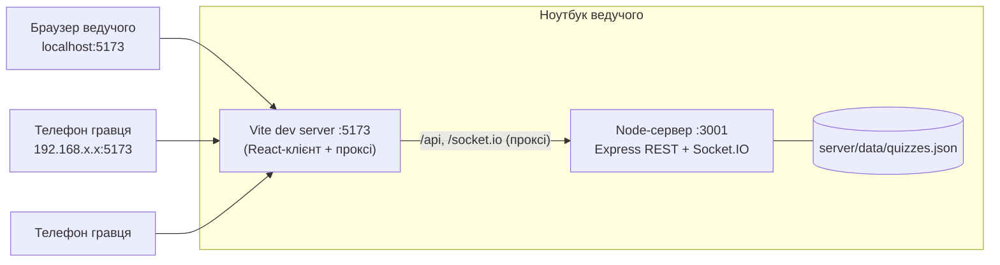
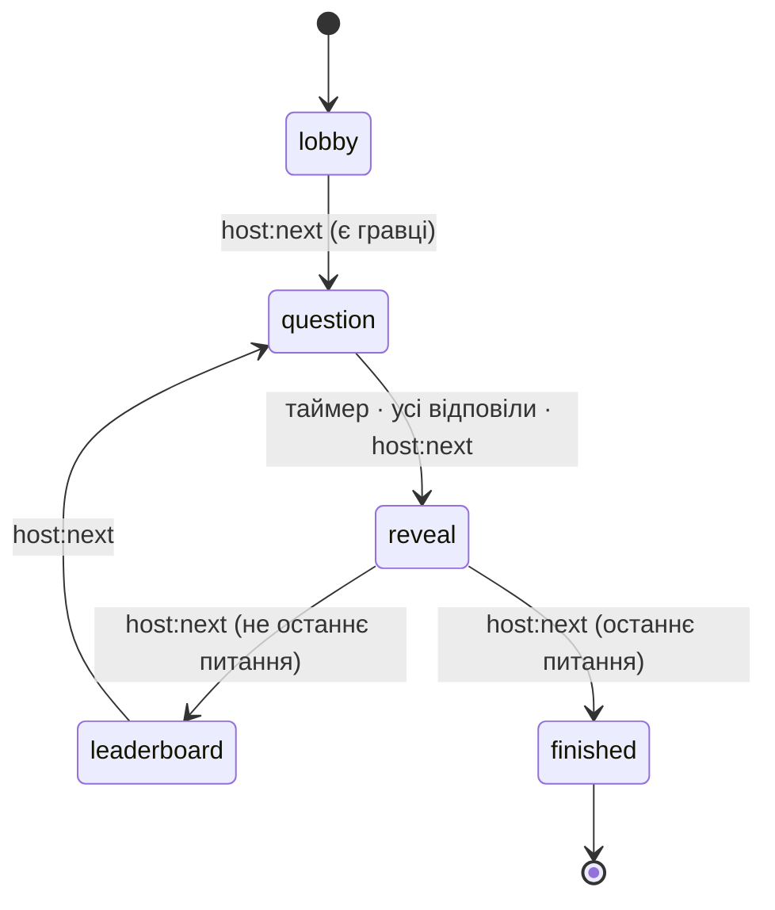

# QuizRoom — спільна частина плану

Квіз-платформа реального часу для студентської презентації: ведучий запускає квіз на ноутбуці (проєктор), учасники заходять з телефонів за PIN-кодом або QR, відповідають на час і бачать таблицю лідерів.

Цей документ читають **обидва** кодери. Він описує продукт, архітектуру, контракт між сервером і клієнтом та правила роботи. Конкретні етапи — у файлах ролей.

## 0. Карта документів

| Файл | Що в ньому | Хто читає |
|---|---|---|
| `docs/00-common.md` | продукт, архітектура, **контракт**, правила, інтеграція, демо | обидва |
| `docs/01-stage-0.md` | етап 0: каркас монорепо, точний вміст файлів | A виконує, B перевіряє |
| `docs/A-server.md` | етапи A1–A5 (сервер) | кодер A |
| `docs/B-client.md` | етапи B1–B6 (клієнт) | кодер B |
| `docs/progress-A.md`, `docs/progress-B.md` | журнал виконання етапів | кожен веде свій, читає обидва |
| `shared/src/index.ts` | контракт у коді (зʼявляється на етапі 0) | обидва, **тільки читання** |

**Ідентифікатори.** Етапи: `0`, `A1…A5`, `B1…B6`, `I`. Критерії приймання: `A2-AC3` (етап A2, критерій 3). Правила: `R1…R12`. Граблі: `G1…G13`.

**Шаблон етапу** (однаковий в усіх файлах):

- **Мета** — один-два речення, що має запрацювати.
- **Залежить від** — які етапи мають бути завершені і як це перевірити.
- **Файли** — що створити або змінити.
- **Вимоги** — нумерований перелік того, що реалізувати.
- **Поза межами етапу** — чого НЕ робити зараз.
- **Acceptance criteria** — перевірювані твердження з ID.
- **Перевірка** — команди, які має виконати кодер.
- **Ручна перевірка** — що перевірити очима в браузері й на телефоні.

## 1. Продукт

### 1.1 Ролі

- **Ведучий** — ноутбук + проєктор. Створює й редагує квізи, запускає гру, перемикає фази кнопкою «Далі».
- **Гравець** — телефон. Сканує QR або вводить PIN, вказує імʼя, відповідає на питання.

### 1.2 Сценарій гри

1. Ведучий відкриває список квізів, тисне «Запустити» → створюється кімната з 6-значним PIN.
2. На проєкторі — лобі: PIN, QR, список гравців, що приєднались.
3. Гравці сканують QR (або вводять адресу й PIN), вказують імʼя, потрапляють у лобі.
4. Ведучий тисне «Почати». Для кожного питання:
   - **question** — на проєкторі питання, варіанти, таймер, лічильник відповідей; на телефоні — кнопки варіантів;
   - **reveal** — правильна відповідь і розподіл відповідей; гравець бачить «правильно / неправильно» і скільки балів отримав;
   - **leaderboard** — топ-5; гравець бачить своє місце.
5. Після останнього питання — **finished**: пʼєдестал топ-3 і повна таблиця.

### 1.3 Що входить у MVP

- CRUD квізів (питання з 2–4 варіантами, одна правильна відповідь, ліміт часу на питання).
- Кімнати за PIN, вхід за QR, до 50 гравців.
- Відповіді на час, бали залежать від швидкості, таблиця лідерів.
- Перепідключення: оновлення сторінки або короткий обрив мережі не викидає з гри.
- Боти для демо (заповнюють кімнату «гравцями»).

### 1.4 Що свідомо НЕ робимо

Авторизація, акаунти, ролі, паролі, токени, HTTPS, rate limiting, санітизація «від зловмисників», база даних, Docker, CI/CD, деплой, i18n, картинки в питаннях, кілька правильних відповідей, командний режим, звуки, тести UI, ESLint/Prettier-конфіги. Якщо чогось немає в плані — цього не робимо.

## 2. Архітектура



Чотири принципи, на яких тримається синхронізація (їх і треба розповідати на захисті):

1. **Сервер — єдине джерело правди.** Фаза гри, таймер, бали, місця існують лише на сервері в памʼяті. Клієнт нічого не рахує, тільки показує.
2. **Синхронізація знімками (snapshots).** Після будь-якої зміни сервер надсилає кожному учаснику *повний* знімок стану кімнати: ведучому — `host:state`, кожному гравцю — персональний `player:state`. Немає дрібних подій «гравець зайшов», «питання почалось». Клієнт — чиста функція «стан → екран», розсинхронізуватись неможливо.
3. **Ідемпотентний join.** Сторінка гри надсилає `host:join` / `player:join` під час завантаження і **на кожну подію `connect` сокета**. Сервер у відповідь привʼязує сокет і шле свіжий знімок. Оновлення сторінки, сон телефона і обрив мережі обробляються одним і тим самим кодом.
4. **Дедлайн, а не тікання.** Сервер не шле «залишилось N секунд». У знімку є `endsAt` (серверний час завершення) і `serverNow`. Клієнт обчислює різницю годинників і сам малює зворотний відлік; закриває питання все одно сервер своїм `setTimeout`.

Команди клієнт → сервер (їх усього пʼять) завжди мають ack-відповідь `{ ok: true } | { ok: false, error }`.

## 3. Стек

Версії перевірені разом (чисте встановлення, typecheck, тести, збірка, dev-проксі REST і WebSocket). Не змінювати.

| Що | Пакет | Версія |
|---|---|---|
| Середовище | Node.js | ≥ 22.12 (перевірено на 26.4), npm workspaces |
| Мова | `typescript` | ^7.0 |
| Сервер | `express` | ^5.0 |
| Realtime | `socket.io`, `socket.io-client` | ^4.8 |
| Запуск TS на сервері | `tsx` | ^4.19 (без етапу збірки) |
| Тести | `vitest` | ^5.0 (сервер: логіка гри; клієнт: тільки чисті функції з `lib/`) |
| Клієнт | `react`, `react-dom` | ^19.0 |
| Збірка клієнта | `vite`, `@vitejs/plugin-react` | ^8.0, ^6.0 |
| Роутинг | `react-router-dom` | ^7.0 (тільки `BrowserRouter` + `Routes`, без data/framework-режиму) |
| QR | `qrcode.react` | ^4.0 (`QRCodeSVG`) |
| Стилі | звичайний CSS + CSS-змінні | без Tailwind, без UI-бібліотек |
| Стан клієнта | `useState` / хуки | без Redux, Zustand, React Query |
| Сховище квізів | JSON-файл | без БД |

## 4. Структура репозиторію і зони відповідальності

```
quiz-room/
├── package.json            # workspaces + скрипти        (етап 0, далі не чіпати)
├── tsconfig.base.json      #                             (етап 0, далі не чіпати)
├── README.md               # як запустити                (A)
├── docs/                   # цей план
├── shared/                 # КОНТРАКТ — заморожений після етапу 0
│   └── src/index.ts
├── server/                 # зона A
│   ├── src/
│   └── scripts/
└── client/                 # зона B
    └── src/
```

| Шлях | Власник | Інший кодер |
|---|---|---|
| `server/**`, `README.md` | A | тільки читає |
| `client/**` | B | тільки читає |
| `shared/**`, кореневі `package.json`, `tsconfig.base.json`, `.gitignore` | ніхто (заморожено) | зміни лише за §9 |
| `docs/progress-A.md` | A | читає |
| `docs/progress-B.md` | B | читає |
| решта `docs/**` | обидва | змінюється лише за домовленістю |

Скрипти в корені (доступні після етапу 0):

| Команда | Що робить | Працює з етапу |
|---|---|---|
| `npm run dev` | сервер :3001 + клієнт :5173 разом | 0 |
| `npm run dev:server` / `npm run dev:client` | окремо | 0 |
| `npm run typecheck` | `tsc --noEmit` у всіх трьох пакетах | 0 |
| `npm test` | vitest у `server` і `client` | 0 (перші тести зʼявляються на A1 і B1) |
| `npm run build` | збірка клієнта в `client/dist` | 0 |
| `npm run smoke` | самодостатній e2e-прогін сервера | A2 |
| `npm run bots -- --pin 123456 --count 10` | боти в наявну кімнату | A4 |
| `npm start` | сервер роздає зібраний клієнт на :3001 | A5 |

## 5. Правила для кодерів (R1–R12)

- **R1. Своя зона.** Змінюй тільки файли своєї зони (§4). Потрібна зміна в чужій — зупинись і запиши запит у свій progress-файл.
- **R2. Контракт заморожений.** `shared/**` не редагується. Імпортуй типи, константи й функції з `@quiz/shared`, не дублюй їх у себе. Зміна — лише за §9.
- **R3. Жодних нових залежностей.** Усе потрібне встановлено на етапі 0. `npm install <щось>` заборонено: це ламає `package-lock.json` другому кодеру.
- **R4. Жодної «безпеки» й інфраструктури.** Нічого з §1.4. Не додавай авторизацію, CORS-обмеження, helmet, валідаційні бібліотеки, Docker, CI.
- **R5. Простота понад усе.** Код мають зрозуміти й пояснити на захисті двоє студентів. Файл — до ~200 рядків, функція — до ~40. Без абстракцій «на майбутнє», без патернів заради патернів, без класів там, де досить функції. Без `any`, `@ts-ignore`, `as unknown as`.
- **R6. Сервер — джерело правди.** Клієнт не обчислює бали, місця, фази і не «вгадує» наступний стан. Виняток один: оптимістичне блокування кнопок після відповіді (B5).
- **R7. Мова.** Тексти інтерфейсу — українською. Ідентифікатори й коментарі в коді — англійською. Коментар пояснює «чому», а не «що».
- **R8. Працює без інтернету.** Жодних CDN, Google Fonts, зовнішніх картинок і запитів назовні: на презентації буде локальна мережа.
- **R9. Критерії не редагуються.** Не можна послаблювати AC, видаляти чи вимикати тести, щоб «стало зелено». Не проходить — виправляй код або чесно пиши, що не вдалось.
- **R10. Один етап за раз.** Не реалізуй наперед речі з наступних етапів і не переробляй завершені без потреби.
- **R11. Стиль.** ES-модулі, іменовані експорти (без `export default`, крім конфігів), 2 пробіли, одинарні лапки, крапка з комою. Імпорти з `@quiz/shared` — одним рядком з пакета, без глибоких шляхів.
- **R12. Git.** Коміти тільки у свою гілку (`server` або `client`), формат `feat(server): A2 — rooms and lobby`. Не пуш, не мердж і не `git add -A` чужих файлів без домовленості з напарником.

## 6. Контракт

Код контракту — `shared/src/index.ts` (створюється на етапі 0 з `docs/01-stage-0.md`). Тут — його поведінка. Якщо цей розділ і файл розходяться, це помилка плану: зупинись і обговори з напарником.

### 6.1 REST API (квізи)

База — `/api`. Тіла запитів і відповідей — JSON. Будь-яка не-2xx відповідь має тіло `ApiError`: `{ error: string, details?: string[] }`.

| Метод і шлях | Тіло запиту | Успіх | Помилки |
|---|---|---|---|
| `GET /api/health` | — | 200 `{ "ok": true }` | — |
| `GET /api/config` | — | 200 `ServerConfig` | — |
| `GET /api/quizzes` | — | 200 `QuizSummary[]`, новіші (`updatedAt`) першими | — |
| `GET /api/quizzes/:id` | — | 200 `Quiz` | 404 |
| `POST /api/quizzes` | `QuizInput` | 201 `Quiz` | 400 (`details` = результат `validateQuizInput`) |
| `PUT /api/quizzes/:id` | `QuizInput` | 200 `Quiz` | 400, 404 |
| `DELETE /api/quizzes/:id` | — | 204 без тіла | 404 |
| будь-який інший `/api/*` | — | — | 404 `ApiError` (JSON, не HTML) |

Валідація — спільна функція `validateQuizInput()` з контракту: редактор викликає її перед збереженням, сервер — перед записом. Рядки перед збереженням обрізаються (`trim`).

### 6.2 Події Socket.IO

Підключення: той самий origin, стандартний шлях `/socket.io`, без неймспейсів і без auth.

Клієнт → сервер (кожна має ack):

| Подія | Payload | Успішний ack | Можливі помилки |
|---|---|---|---|
| `host:create` | `{ quizId }` | `{ ok: true, pin }` | `BAD_REQUEST`, `QUIZ_NOT_FOUND` |
| `host:join` | `{ pin }` | `{ ok: true }` | `BAD_REQUEST`, `ROOM_NOT_FOUND` |
| `host:next` | — | `{ ok: true }` | `NOT_IN_ROOM`, `NO_PLAYERS`, `GAME_FINISHED` |
| `player:join` | `{ pin, name, playerId }` | `{ ok: true }` | `BAD_REQUEST`, `ROOM_NOT_FOUND`, `INVALID_NAME`, `NAME_TAKEN`, `ROOM_FULL`, `GAME_FINISHED` |
| `player:answer` | `{ optionIndex }` | `{ ok: true }` | `BAD_REQUEST`, `NOT_IN_ROOM`, `NOT_ACCEPTING_ANSWERS`, `ALREADY_ANSWERED`, `INVALID_OPTION` |

Сервер → клієнт:

| Подія | Payload | Коли |
|---|---|---|
| `host:state` | `HostState` | після кожної зміни кімнати — усім сокетам ведучого цієї кімнати |
| `player:state` | `PlayerState` | після кожної зміни кімнати — кожному підключеному гравцю свій знімок |
| `room:closed` | — | кімнату видалено на сервері (вийшов час життя) |

Тексти помилок для інтерфейсу — `ERROR_MESSAGES[code]` з контракту.

### 6.3 Фази і поля знімка



Які поля заповнені в якій фазі (решта — як вказано):

| Поле | lobby | question | reveal | leaderboard | finished |
|---|---|---|---|---|---|
| `questionIndex` | `-1` | i | i | i | останній індекс |
| `question` | `null` | є | є | є | `null` |
| `endsAt` | `null` | **є** | `null` | `null` | `null` |
| `correctIndex` | `null` | **`null`** | є | є | `null` |
| `HostState.answeredCount` | `0` | поточне | підсумок | підсумок | `0` |
| `HostState.answerCounts` | `null` | `null` | є | є | `null` |
| `HostState.leaderboard` | усі з 0 | бали **до** цього питання | оновлені | оновлені | фінальні |
| `PlayerState.myAnswer` | `null` | `null` або індекс | `null` або індекс | `null` або індекс | `null` |
| `PlayerState.lastResult` | `null` | `null` | є | є | `null` |
| `PlayerState.me.score` | `0` | **до** цього питання | оновлений | оновлений | фінальний |

Два інваріанти, які перевіряються тестами:

- у фазі `question` жоден знімок не містить правильної відповіді (`correctIndex === null`) і не видає її опосередковано (бали й `lastResult` не змінюються до `reveal`);
- `serverNow` — час сервера в момент побудови знімка.

Гравець, який не відповів: у `reveal` має `myAnswer: null`, `lastResult: { correct: false, points: 0 }`.

### 6.4 Переходи

`host:next` — єдина команда керування. Що вона робить залежно від поточної фази:

| Поточна фаза | Дія `host:next` |
|---|---|
| `lobby` | якщо гравців 0 → помилка `NO_PLAYERS`; інакше стартує питання 0 |
| `question` | достроково завершує питання → `reveal` |
| `reveal` | останнє питання → `finished`; інакше → `leaderboard` |
| `leaderboard` | стартує наступне питання |
| `finished` | помилка `GAME_FINISHED` |

Автоматичний перехід `question → reveal` відбувається без ведучого у двох випадках:

- спрацював серверний таймер (`endsAt`);
- відповіли **всі підключені** гравці (і підключений хоча б один). Перевіряється після кожної відповіді і після кожного відключення гравця.

### 6.5 Правила кімнати

1. **PIN** — 6 цифр, перша не нуль, унікальний серед активних кімнат. Кімната зберігає **копію** квізу на момент створення: редагування квізу не впливає на гру, що вже йде.
2. **Імʼя гравця** — 1–16 символів після `trim` (`isValidPlayerName`). Порівняння імен — без урахування регістру.
3. **`player:join` обробляється в такому порядку:**
   1. імʼя некоректне → `INVALID_NAME`;
   2. гравець із таким `playerId` уже є в кімнаті → **перепідключення**: сокет привʼязується до нього, імʼя й бали лишаються (працює в будь-якій фазі, також у `finished`);
   3. є гравець із таким самим імʼям: якщо він зараз підключений → `NAME_TAKEN`; якщо відключений → новий сокет **перехоплює** цього гравця разом із балами (працює в будь-якій фазі);
   4. фаза `finished` → `GAME_FINISHED`;
   5. у кімнаті вже 50 гравців → `ROOM_FULL`;
   6. інакше створюється новий гравець із 0 балів.
4. **Пізній вхід дозволений** у фазах `lobby`, `question`, `reveal`, `leaderboard`. Хто зайшов під час `question`, може відповісти на поточне питання.
5. **Відключення гравця** не видаляє його: `connected: false`, бали зберігаються. Відключений не блокує авто-перехід до `reveal`.
6. **Ведучий** не ідентифікується нічим, крім PIN: будь-який сокет, що надіслав `host:join` з PIN кімнати, стає її ведучим (їх може бути кілька — наприклад, дві вкладки). Відключення ведучого гру не зупиняє: таймери йдуть, кімната живе.
7. **Відповідь** — одна на питання, приймається лише у фазі `question`. Змінити відповідь не можна.
8. **Час життя кімнати** — 2 години від створення, потім `room:closed` і видалення. Перезапуск сервера знищує всі кімнати; клієнти під час перепідключення отримають `ROOM_NOT_FOUND`.

### 6.6 Бали

Неправильна відповідь або відсутність відповіді — 0. Правильна:

```
ratio  = clamp(elapsedMs / limitMs, 0, 1)        // elapsedMs — від старту питання до отримання відповіді сервером
points = round(MAX_POINTS − (MAX_POINTS − MIN_POINTS) × ratio)   // 1000 → 500
```

Тобто миттєва правильна відповідь — 1000, посередині часу — 750, в останню мить — 500. Бали нараховуються в `score` тільки в момент переходу до `reveal`. Місце (`rank`) — позиція в сортуванні за балами за спаданням; при рівних балах вище той, хто приєднався раніше. Спільних місць немає.

### 6.7 Синхронізація часу

- Клієнт, отримавши знімок, запамʼятовує `clockOffset = state.serverNow − Date.now()`.
- Залишок часу: `remainingMs = max(0, endsAt − (Date.now() + clockOffset))`.
- Коли в клієнта залишок дійшов до 0, він блокує кнопки й чекає на знімок із фазою `reveal`. Сам фазу не перемикає.

### 6.8 Маршрути клієнта і адреса для входу

| Маршрут | Сторінка | Пристрій |
|---|---|---|
| `/` (опційно `?pin=123456`) | вхід гравця: PIN + імʼя | телефон |
| `/play/:pin` | гра гравця | телефон |
| `/quizzes` | список квізів | ноутбук |
| `/quizzes/new`, `/quizzes/:quizId` | редактор квізу | ноутбук |
| `/host/:pin` | гра ведучого | ноутбук / проєктор |
| `/dev` | галерея екранів на фікстурах | тільки розробка |

**Адреса в QR** будується на клієнті ведучого: `<origin>/?pin=<PIN>`. Якщо ведучий відкрив сторінку через `localhost` / `127.0.0.1`, hostname замінюється на `lanIp` з `GET /api/config` (порт лишається той самий). Якщо сторінка відкрита за IP або доменом тунелю — береться `window.location.origin` як є.

**Ідентичність гравця** зберігається в `sessionStorage` (не `localStorage`): так кожна вкладка — окремий гравець (зручно тестувати), а оновлення сторінки гравця не губить.

## 7. Етапи і точки синхронізації

| Етап | Назва | Хто | Залежить від | Розмір |
|---|---|---|---|---|
| 0 | Каркас монорепо і контракт | A (B перевіряє) | — | S |
| A1 | REST API квізів, сховище, демо-дані | A | 0 | M |
| A2 | Кімнати і лобі через Socket.IO | A | A1 | M |
| A3 | Ігровий рушій: фази, таймер, бали | A | A2 | L |
| A4 | Боти і авто-ведучий для демо | A | A3 | M |
| A5 | Режим одного порту, час життя кімнат, логи, README | A | A4 | S |
| B1 | Каркас клієнта: роутинг, дизайн-токени, UI-кіт | B | 0 | M |
| B2 | Ігрові компоненти, фікстури, екрани ведучого, `/dev` | B | B1 | L |
| B3 | Екрани гравця (mobile-first) | B | B2 | M |
| B4 | Список і редактор квізів | B | B3, **A1** | M |
| B5 | Realtime: хуки, вхід, сторінки гри | B | B4, **A3** (бажано A4) | L |
| B6 | Полірування і стійкість | B | B5 | M |
| I | Спільна інтеграція і репетиція демо | обидва | A5, B6 | M |

```
A:  0 ─ A1 ─ A2 ─ A3 ─ A4 ─ A5 ─┐
            │         │         ├─ I
B:  ─── B1 ─ B2 ─ B3 ─ B4 ─ B5 ─ B6 ─┘
                       ▲    ▲
                 потрібен  потрібен
                    A1        A3
```

B1–B3 не потребують сервера взагалі (екрани малюються на фікстурах), тому кодери не блокують одне одного: поки B робить екрани, A встигає довести сервер до A3.

Точки синхронізації:

- **SP0** — етап 0 змерджено в `main`. Обидва стартують.
- **SP1** — A1 у `main` → B може виконувати B4.
- **SP2** — A3 (краще A4) у `main` → B може виконувати B5.
- **SP3** — A5 і B6 у `main` → спільний етап I.

## 8. Відомі граблі (G1–G13)

Кожен пункт — реальна причина, чому демо ламається в останню мить.

- **G1. `crypto.randomUUID()` не працює на телефоні.** Сторінка, відкрита за `http://192.168.x.x`, не є secure context. На клієнті ID генеруй через `Math.random`. На сервері `crypto.randomUUID()` можна.
- **G2. Wi-Fi університету часто ізолює пристрої.** Телефони не бачать ноутбук. План Б — роздати інтернет із телефона й підключити до цієї точки і ноутбук, і телефони гравців.
- **G3. Фаєрвол macOS/Windows** може блокувати вхідні підключення до Node. Під час першого запуску дозволити.
- **G4. Express 5: `app.get('*', …)` падає.** Для SPA-фолбеку використовуй останній `app.use((req, res) => res.sendFile(…))`.
- **G5. React StrictMode у dev двічі запускає ефекти.** Сокет створюється один раз на рівні модуля; у кожному `useEffect` — симетричний `socket.off(...)`; join-и ідемпотентні.
- **G6. `localStorage` спільний для вкладок.** Дві вкладки стали б одним гравцем. Тільки `sessionStorage`.
- **G7. `100vh` на телефоні** ширший за видиму область. Використовуй `100dvh`.
- **G8. iOS збільшує сторінку**, якщо в `input` шрифт менший за 16px.
- **G9. Телефон засинає → сокет рветься.** Саме тому join ідемпотентний і повторюється на кожен `connect` (§2, принцип 3).
- **G10. Таймери тримають процес Node.** Довгі `setTimeout` (час життя кімнати) — з `.unref()`; скрипти `smoke`/`bots` завершуються явним `process.exit()`.
- **G11. `package-lock.json`.** Конфлікт виникає тільки якщо хтось порушив R3. Лікування: взяти версію з `main` і виконати `npm install`.
- **G12. Не запускай інтерактивні генератори** (`npm create vite`, `npm init`): вони чекають вводу і зависають. Усі файли каркаса дані в `docs/01-stage-0.md`.
- **G13. Подвійний клік по «Далі»** перестрибує фазу. Кнопка блокується до отримання ack (B5).

Попередження npm про `install-scripts` (esbuild, fsevents) під час `npm install` — нешкідливе, нічого робити не треба.

## 9. Процедура зміни контракту

Контракт змінюється тільки якщо без цього неможливо виконати AC.

1. Кодер, який натрапив на проблему, **зупиняє** етап і дописує у свій `docs/progress-X.md` блок «Запит на зміну контракту»: що не так, яка мінімальна зміна потрібна, кого вона зачепить.
2. Обидва погоджують зміну.
3. Зміну вносить **A** окремим комітом `chore(shared): …` прямо в `main`, оновлюючи одночасно `shared/src/index.ts` і відповідний розділ §6 цього документа.
4. Обидва підтягують `main` у свої гілки й запускають `npm run typecheck`.

## 10. Етап I — спільна інтеграція

**Мета:** переконатись, що дві частини працюють разом на реальних телефонах, і відрепетирувати демо.

**Залежить від:** A5 і B6 у `main`.

**Як виконувати:** обидва за одним ноутбуком, `npm run dev`, мінімум два реальні телефони в тій самій мережі. Знайдені дефекти виправляє власник зони у своїй гілці, після чого сценарій повторюється.

**Acceptance criteria:**

- **I-AC1.** `npm install && npm run typecheck && npm test && npm run smoke && npm run build` на чистому клоні — усе зелене.
- **I-AC2.** Повна гра: ведучий на ноутбуці, 2+ реальні телефони через QR, 10 ботів. Усі фази проходять, на всіх пристроях стан однаковий, фінальна таблиця збігається з тим, що бачать гравці.
- **I-AC3.** Таймер на проєкторі й на телефонах розходиться не більше ніж на 1 секунду.
- **I-AC4.** Оновлення сторінки телефона в кожній із фаз (`lobby`, `question` до відповіді, `question` після відповіді, `reveal`, `leaderboard`, `finished`) повертає гравця в ту саму фазу з тими самими балами.
- **I-AC5.** Оновлення сторінки ведучого в кожній фазі повертає той самий екран; таймер продовжує йти з правильного значення.
- **I-AC6.** Телефон заблоковано на 15 секунд під час `question` і розблоковано — гравець автоматично повертається в гру без дій.
- **I-AC7.** Усі відповіли до завершення таймера → `reveal` настає одразу. Ніхто не відповів → `reveal` настає по таймеру.
- **I-AC8.** Гравець, що зайшов посеред гри, потрапляє в поточну фазу і грає з наступного (або поточного) питання.
- **I-AC9.** Друга гра одразу після першої (нова кімната) працює; старі гравці можуть зайти під тими самими іменами.
- **I-AC10.** Режим одного порту: `npm run build && npm start`, гра проходить через `http://<LAN-IP>:3001`.
- **I-AC11.** Зупинка сервера посеред гри: клієнти показують банер про втрату звʼязку; після запуску сервера — зрозумілий екран «гру не знайдено» з кнопкою на головну, без білого екрана й помилок у консолі.
- **I-AC12.** Демо-сценарій із §11 пройдено двічі поспіль без збоїв.

## 11. Сценарій демо і чеклист

**Перед презентацією:**

1. Ноутбук і телефони в одній мережі (G2), фаєрвол дозволяє Node (G3).
2. `npm run dev` (або `npm run build && npm start`), у консолі сервера видно LAN-адресу.
3. Відкрити з телефона `http://<LAN-IP>:5173` — сторінка входу завантажується.
4. Підготовлений демо-квіз на 5–6 питань із коротким таймером (10–15 с).
5. Екран ноутбука не засинає; масштаб браузера 100%; вкладка ведучого на проєкторі.

**Сценарій (5–7 хвилин):**

1. Показати список квізів, відкрити редактор, додати одне питання наживо, зберегти.
2. «Запустити» → лобі з PIN і QR. Попросити аудиторію відсканувати.
3. У другому терміналі: `npm run bots -- --pin <PIN> --count 12` — лобі наповнюється.
4. «Почати». Зіграти 2–3 питання, коментуючи: таймер синхронний на всіх пристроях; авто-перехід, коли всі відповіли; бали за швидкість.
5. Наживо оновити сторінку на одному телефоні посеред питання — гравець повертається в гру (принцип 3).
6. Дограти до пʼєдесталу.
7. Відкрити діаграми з §2 і §6.3 і пояснити чотири принципи синхронізації.

## 12. Definition of Done проєкту

Проєкт готовий, коли виконано всі AC етапів 0, A1–A5, B1–B6 та I, і:

- у репозиторії немає коду поза планом (§1.4, R4);
- `README.md` дозволяє запустити проєкт із нуля трьома командами;
- обидва кодери можуть пояснити будь-який файл своєї зони.
